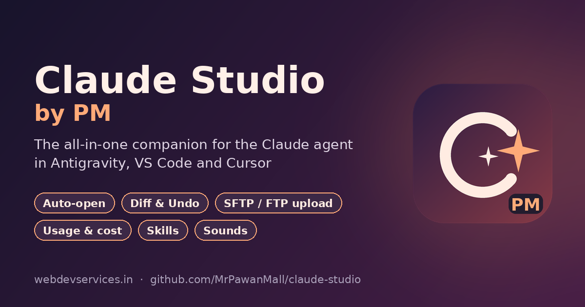

<p align="center">
  <a href="https://webdevservices.in/claude-studio-vs-code-extension/"></a>
</p>

<h1 align="center">Claude Studio by PM</h1>

<p align="center">
  <b>The all-in-one companion for the Claude agent in Antigravity, VS Code and Cursor.</b><br>
  See every file Claude edits, review and undo its work, upload to your server, track usage and cost, and manage skills — all from one sidebar.
</p>

<p align="center">
  <a href="https://github.com/MrPawanMall/claude-studio/releases/latest"></a>
  <a href="LICENSE"></a>
  <a href="https://www.webdevservices.in/"></a>
</p>

<p align="center">
  <b><a href="https://webdevservices.in/claude-studio-vs-code-extension/">🌐 Extension page</a></b> ·
  <b><a href="https://github.com/MrPawanMall/claude-studio/releases/latest">⬇ Download</a></b> ·
  <b><a href="https://webdevservices.in/extensions/">More extensions by PM</a></b>
</p>

---

## Why

When the Claude agent works inside your editor it changes files on disk — but you don't always see them. Claude Studio opens each file the moment Claude touches it (like Antigravity's own agent does), keeps a history of every change grouped by task, and lets you diff, undo, check and upload that work in a click.

## Features

### 👁 Auto-open what Claude edits
- Opens every file Claude edits or creates, scrolls to the first change and flashes the changed lines.
- Keeps your cursor in the Claude chat and never covers the chat tab.
- Green change bars stay beside edited lines until you review them.
- Ignores your own saves and bulk changes (git checkout, composer/npm install, builds), plus `vendor`, `node_modules`, `writable`, logs and binary files.
- Tab limit, **close all tabs Claude opened**, **pause for 10/30/60 minutes**, per-project on/off.

### 🔍 Review and undo
- **Changes panel** — every file Claude touched, grouped by task, with `+added −removed` counts.
- **Show diff** — before/after view of any change (click a file in the panel, or the editor title button).
- **Undo one file** — puts a single file back as it was before Claude's change.
- **Undo whole task** — reverts every file of a task in one click (new files go to the trash).
- **Checkpoints** — mark a point before a big task, then revert everything Claude changed since.
- **Copy task summary** — a ready-made list of changed files for a commit message or report.

### ✅ Code quality
- **PHP syntax check** (`php -l`) after every Claude edit; errors appear in the Problems panel with a jump-to-line button.
- Optional **auto-format** after Claude edits a file.

### ☁️ Built-in SFTP / FTP / FTPS upload
- Reads your existing **`.vscode/sftp.json`** (same format as the popular SFTP extension — profiles, `context`, `ignore`, `uploadOnSave` all work). No other extension needed.
- **Uploads Claude's edits automatically** as soon as each file is finished — or all together when the task ends, or only when you click *Upload*.
- **Upload on save** for your own edits.
- **Blocks PHP files with syntax errors**, so a broken file never reaches your server.
- **Asks before uploading to production** (`prod`, `production`, `live` profiles — configurable).
- **Passwords in secure storage** (never in plain text), with a one-click *Move passwords to secure storage* for existing configs.
- **Server key verification** (SSH host fingerprint, trust-on-first-use, blocks changed keys).
- Upload status in the status bar, upload history with retry, **download from server**, **compare local vs server**, switch profiles.

### 📊 Claude usage & cost
- Status bar like `5h:12% 7d:44% | research:$67.34` with a detailed hover.
- Tokens and **cost per 5 hours / day / 7 days / project**, read locally from Claude Code's logs and priced with Anthropic's published rates (editable).
- Optional **5-hour / 7-day plan usage** percentages.
- **Dashboard** with 30-day cost chart, usage by hour, by model and by project.
- **Daily and weekly budget alerts**, plan-limit alerts.

### ✨ Skills manager
- See all **personal** (`~/.claude/skills`) and **project** (`.claude/skills`) skills; open, edit, disable/enable or delete them.
- **Browse and install skills from multiple sources**: GitHub repositories (Anthropic's official skills repo is built in), links to `.zip` or `SKILL.md` files, local folders, or a `.zip` on your computer.
- **Preview before installing** — read the SKILL.md and see every file, with scripts flagged ⚠.
- Install for all projects or just this one. **Create a new skill** from a template. **Check for updates**.

### 🔔 Notifications with sounds
- Claude Studio's own notification system: pop-ups with action buttons (*Review*, *Undo task*, *Upload*, *Copy summary*), plus a **Notifications panel** with history and an unread badge.
- **Sounds for each event** — 6 built-in sounds or **your own `.wav` / `.mp3`**; preview while choosing; volume; reset to default.
- **Do Not Disturb**, and choose which notifications pop up.

### 🔄 Browser live reload
- Reloads your local site after PHP/HTML/JS changes (CSS updates without a full reload). Add one script tag to your dev layout.

### ℹ️ About & credits
- Built-in About page with author details, partner and tools.

## Install

Full guide with screenshots and FAQ on the **[Claude Studio extension page](https://webdevservices.in/claude-studio-vs-code-extension/)**.

- **VS Code Marketplace** — search for *Claude Studio by PM* (ID `pawanmall.claude-studio-by-pm`).
- **Open VSX** (used by **Antigravity**, Cursor, VSCodium) — search for *Claude Studio by PM* (ID `pawanmall.claude-studio-by-pm`).
- **Manual** — download the `.vsix` from [Releases](https://github.com/MrPawanMall/claude-studio/releases), then in the Extensions panel open the `···` menu → **Install from VSIX…**.

## Quick start

1. Install, then click the **Claude Studio** icon in the activity bar.
2. Ask Claude to change something — the file opens and the change appears in **Changes**.
3. *(Optional)* **Uploads → Set Up Server** to create `.vscode/sftp.json`, or keep your existing one.
4. *(Optional)* **Usage → Show 5h / 7d plan usage**.
5. *(Optional)* **Skills → Browse** to install skills.

Click **👁 Claude Studio** in the status bar any time for the quick menu.

## Server upload (`.vscode/sftp.json`)

```jsonc
{
    "name": "My Server",
    "protocol": "sftp",            // "sftp" or "ftp" ("secure": true for FTPS)
    "host": "example.com",
    "port": 22,
    "username": "username",
    "remotePath": "/public_html",
    "uploadOnSave": true,
    "ignore": [".vscode", ".git", ".claude", "node_modules", "writable/cache"],
    "profiles": {
        "dev":  { "remotePath": "/staging" },
        "prod": { "remotePath": "/public_html" }
    },
    "defaultProfile": "dev"
}
```

Leave out `"password"` — Claude Studio asks once and keeps it in the editor's secure storage. SSH keys: `"privateKeyPath": "~/.ssh/id_ed25519"` (and `"passphrase": true` to be asked once).

**What happens to Claude's edits** — setting `claudeStudio.upload.claudeEdits`:

| Value | Behaviour |
|---|---|
| `auto` *(default)* | Upload each file as soon as Claude finishes writing it |
| `afterTask` | Upload all of the task's files together when Claude finishes |
| `ask` | Show an **Upload** button in the "Claude finished" notification |
| `off` | Never upload Claude's edits automatically |

Uploads to profiles named `prod`, `production` or `live` always ask first (`claudeStudio.upload.confirmProfiles`).

## Notification sounds

Run **Claude Studio: Change Notification Sounds…**, pick an event, then a built-in sound (it plays as you move through the list) or **Custom sound file…** to use your own `.wav`/`.mp3`/`.ogg`/`.m4a`. **Reset Sounds to Default** puts everything back.

| Event | Default sound |
|---|---|
| Claude finished a task | chime |
| Upload failed | error |
| PHP syntax error | error |
| Budget / usage alert | alert |
| Skill installed | pop |
| Upload finished | none |

## Live reload

1. Run **Claude Studio: Copy Live Reload Script Tag** (it offers to turn live reload on).
2. Paste the tag before `</body>` in your **local/dev** layout only:
   `<script src="http://127.0.0.1:35730/claude-studio-reload.js"></script>`

## Commands

Open the Command Palette and type **Claude Studio** — all 55+ commands are there, including *Quick Menu*, *Undo Whole Claude Task*, *Create Checkpoint*, *Upload to Server*, *Compare with Server*, *Open Usage Dashboard*, *Browse Skills…*, *Change Notification Sounds…* and *About*.

## Security & privacy

- **No telemetry.** Claude Studio doesn't collect or send any data about you or your code.
- **Network use is limited to what you turn on:** your own server (uploads), GitHub / the links you add (skills), and `api.anthropic.com` for the optional plan-usage check (off by default; asks first).
- **Secrets** (server passwords, SSH passphrases, GitHub token) live in the editor's **secure storage** (Windows Credential Manager / macOS Keychain / libsecret), never in settings or logs.
- **SSH host keys are verified** (trust-on-first-use, changed keys are blocked). **FTPS certificates are verified**; plain FTP shows a warning.
- **Workspace Trust:** in untrusted folders, uploads, PHP checks, live reload and project skill installs stay off. Settings that run programs (`php.executablePath`) or hold credentials can only be set in your user settings, never by a project.
- **Webviews** use a strict Content-Security-Policy with no remote code; links open only if they are `https:`, `mailto:` or `tel:`.
- **Skill installs** are https-only, size-capped, protected against path traversal ("zip slip"), and always shown for review first.
- **Live reload** listens on `127.0.0.1` only, checks the `Host` header, and serves nothing but its own script.
- **Undo/revert** moves deleted files to the trash instead of deleting them.

See [SECURITY.md](SECURITY.md) to report a vulnerability.

## FAQ

**Does it work with Claude Code in the terminal too?** Yes — it watches files on disk, so it works with the Claude Code extension, Claude Code in a terminal, or any agent.

**Will it upload Composer/npm installs?** No. Changes to more than 5 files at once (configurable) are treated as tool activity and ignored, and `vendor`/`node_modules` are excluded.

**Are the costs exact?** They are estimates from Claude Code's local logs and Anthropic's published prices. On a subscription plan you're billed by plan, not per token — the numbers show what the same usage would cost on the API.

## Credits

| | |
|---|---|
| **Extension** | Claude Studio by PM |
| **Author** | Pawan Mall |
| **Website** | [www.pawanmall.in](https://www.pawanmall.in/) |
| **Plugin Website** | [www.webdevservices.in](https://www.webdevservices.in/) |
| **Extension Page** | [webdevservices.in/claude-studio-vs-code-extension](https://webdevservices.in/claude-studio-vs-code-extension/) |
| **Email** | [pawan.webmaster@gmail.com](mailto:pawan.webmaster@gmail.com) |
| **Mobile** | [8826809995](tel:8826809995) |
| **GitHub** | [github.com/MrPawanMall](https://github.com/MrPawanMall) |

### 🏆 Exclusive Partner — [MyQRStudio](https://myqrstudio.in/)
*Create QR Codes That Do More.* → **[Visit MyQRStudio](https://myqrstudio.in/)**

### Other tools and resources

**AI Tools** — [Free Text to Speech Pro](https://webdevservices.in/tools/text-to-speech/) · [AI API Key Validator](https://webdevservices.in/tools/ai-key-validator/) · [AI SEO Schema Generator](https://webdevservices.in/tools/ai-seo-schema-generator/) · [WhatsApp Widget Generator](https://webdevservices.in/tools/whatsapp-widget-tool/) · [Free Prompt Generator](https://webdevservices.in/tools/free-prompt-generator/) · [Then & Now Hug](https://gemini.google.com/share/fe7179f568ae)

**QR-Masters** ([webdevservices.in/qr](https://webdevservices.in/qr/)) — [Website URL](https://webdevservices.in/qr/tools/url) · [WhatsApp](https://webdevservices.in/qr/tools/whatsapp) · [vCard Profile](https://webdevservices.in/qr/tools/vcard) · [Secure Wi-Fi](https://webdevservices.in/qr/tools/wifi) · [YouTube Video](https://webdevservices.in/qr/tools/youtube) · [App Store](https://webdevservices.in/qr/tools/appstore) · [Fast Email](https://webdevservices.in/qr/tools/email) · [Maps Location](https://webdevservices.in/qr/tools/maps) · [Plain Text](https://webdevservices.in/qr/tools/text)

**Tools** — [Weather Widget Generator](https://webdevservices.in/app/widget/generator/weather.php) · [Twitter Intent Generator](https://webdevservices.in/tools/twitter-intent-generator/) · [Free Image Editor](https://webdevservices.in/demo/free-image-editor/) · [Free Image Converter](https://webdevservices.in/demo/image-converter/) · [Glassmorphism Generator](https://webdevservices.in/tools/glassmorphism-generator/) · [SVG URL Encoder](https://webdevservices.in/svg-url-encoder/) · [Duplicate Word Finder](https://webdevservices.in/tools/duplicate-word-finder/) · [Age Calculator Tool](https://webdevservices.in/age-calculator-tool/) · [Markdown PDF Generator](https://webdevservices.in/demo/Markdown-PDF-Generator)

**WordPress Plugins** — [AI SEO Engine](https://webdevservices.in/ai-seo-engine-wordpress-plugin/) · [WDS Country Dropdown](https://webdevservices.in/wds-country-dropdown-wordpress-plugin-2025/) · [CF7 International Telephone Input](https://webdevservices.in/cf7-international-telephone-input/)

**Shop** — [File Management System (FMS) for Efficient Business Operations](https://webdevservices.in/product/file-management-system-fms/) · [Online Shipment Tracking & Trip Management Web App (CodeIgniter 4 + Bootstrap 5)](https://webdevservices.in/product/advanced-shipment-tracking-web-app/)

**Live Cricket Scores** — [Live Cricket Scores](https://webdevservices.in/live-score/cricket.php)

**Categories** — [Technology](https://webdevservices.in/category/technology/) · [Search Engine Optimization](https://webdevservices.in/category/search-engine-optimization/) · [Web Development](https://webdevservices.in/category/web-development/) · [Language](https://webdevservices.in/category/language/) · [Front-End Development](https://webdevservices.in/category/front-end-development/) · [Artificial Intelligence](https://webdevservices.in/category/artificial-intelligence/) · [Dynamic QR Generator](https://webdevservices.in/qr) · [Web Design](https://webdevservices.in/category/web-design/) · [Tutorials](https://webdevservices.in/category/tutorials/) · [Beginner's Guides](https://webdevservices.in/category/beginners-guides/)

## License

[MIT](LICENSE) © 2026 Pawan Mall

*Claude Studio by PM is an independent project and is not affiliated with, endorsed by, or sponsored by Anthropic. "Claude" is a trademark of Anthropic, PBC.*
